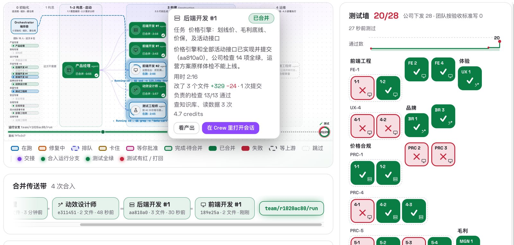

# AI for Software Engineering on AWS: AI-DLC Samples

Teams that already use AI coding assistants usually reach the same next question: how do we run the
AI-Driven Development Life Cycle (AI-DLC) on our own toolchain, against our own definition of done,
through our own release process? This repository answers that question one engineering domain at a
time.

Each sample takes a feature from requirement to a validated release on a realistic toolchain, using
[AI-DLC Workflows 2.0](https://github.com/awslabs/aidlc-workflows) with [Kiro](https://kiro.dev). It
packages what a team needs to repeat the work on its own code: the domain's standards as knowledge the
agents cite and as checks they cannot change, tool connectors (MCP servers) with guardrails, a small
reference project, and a guide for a one-day guided rehearsal. Samples run with Kiro (IDE or CLI) or
[Kiro Crew](https://kiro.dev/docs/crew/).

> [!IMPORTANT]
> **Maturity: early development.** The samples are for learning and evaluation. They are not
> production ready. Review every generated change, and keep human approval on any action that
> touches hardware, production systems or customer data. Generative AI can make mistakes; see the
> [AWS Responsible AI Policy](https://aws.amazon.com/ai/responsible-ai/policy/).

## Samples

| Sample | Scenario | Toolchain highlights | Status |
| --- | --- | --- | --- |
| [AI-DLC agent team on Kiro Crew](samples/agent-team-on-kiro-crew/) | A team of AI-DLC expert agents takes a web feature from a one-sentence requirement through human gates, company checks and an independent review to a local deployment and a sign-off | Kiro Crew app (Python backend, React board), git worktrees, Node.js test runner, Kiro Crew knowledge base | Available |
| [Embedded development](samples/embedded-development/) | Firmware and controller software in C and C++, including model-based design, validated in simulation and on hardware before an engineer signs off the release | AI-DLC plugin `embedded-firmware`; cross toolchain, QEMU, OpenOCD and GDB, serial console, hardware-in-the-loop bench; Kiro on the team's build server | In development |
| [Enterprise application and data](samples/enterprise-application-and-data/) | Making legacy services, ERP, finance and supply-chain systems and their data usable by agents | OpenAPI specifications, row- and column-level access control, governed MCP servers | Planned |
| [Mobile app development, iOS first](samples/mobile-app-development/) | Swift and Kotlin apps on release trains, where the definition of done includes app store review and regulatory rules | Amazon EC2 Mac instances, AWS Device Farm | Planned |

## Sample overview: AI-DLC agent team on Kiro Crew

[`samples/agent-team-on-kiro-crew/`](samples/agent-team-on-kiro-crew/) is the first sample you can install and run.
It turns a one-sentence requirement into a delivery by a team of AI-DLC expert agents, and shows what that changes
for an organization rather than for one engineer.

- **So what: more delivered, earlier revenue, lower cost.** The sample's CTO view opens on a simulated organization
  of 60 people: after it adopts the agent team it delivers 3.1 times as much in 12 weeks, large requirements take
  6.8 days instead of 29.8, new applications and features reach users 8.8 days earlier, and a person-day of work
  costs 77 % less. Those figures are simulated; the sample shows how a new user gets the same measures for their own
  deliveries. In measured runs, a promotion feature built by 8 agents went from requirement to local deployment in
  13 to 20 minutes, of which the agents needed about 7 to 10, and passed all 40 checks, 28 of them issued by the
  company, before a person approved the release.
- **How: AI-DLC, a knowledge base and a team of agents.** An orchestrator follows the AI-DLC phases with human gates
  (scope, build start, release) where a person answers the open questions one by one. The company's standards live
  in a knowledge base that the agents search and cite, and the same rules run as checks the agents cannot change.
  Each role runs as one of the 14 AI-DLC expert agents on its own git branch; failures go back to their owners, and
  an independent reviewer reads the result. Teams are JSON files, so the orchestrator is not tied to its example.
- **Why Kiro Crew.** The sample is a Kiro Crew app. Kiro Crew is open source and provides the agents' sessions, the
  members that make up a team, a knowledge base, memory that builds from the work, and an app platform with explicit
  trust and permissions; the app uses only Kiro Crew's local API.
- **What you need.** A Mac with Kiro Crew and Node.js 22; `setup.sh` installs everything in about 10 minutes and
  `cleanup.sh` removes what it created. A run costs Kiro Crew credits (34 to 51 per delivery in the measured runs) and
  creates no AWS resources.



## Sample overview: embedded development

[`samples/embedded-development/`](samples/embedded-development/) is in development.

- **What.** One firmware feature goes from a requirement and the hardware documents to code that builds with the
  team's cross toolchain, passes unit and simulation tests on an emulated board, and runs on hardware only behind
  guarded tools; the engineer who owns the release signs it off with the evidence in front of them.
- **How.** An AI-DLC plugin, `embedded-firmware`, adds the embedded steps to AI-DLC Workflows 2.0: hardware facts from
  datasheets cited to a page; people deciding at the requirements, build-start, hardware and release gates; blocking
  checks the engine runs at the gates (build, coding rules, memory budget, unit and simulation tests); MCP connectors
  for build, simulator, flash, serial and bench that enforce approval, safe limits and one session per bench.
- **Why.** Embedded work differs from web work: requirements live in datasheets, a build-and-flash loop takes minutes
  to hours, and a failed run can damage hardware. An agent that cannot see the result of its own code is guessing, so
  the sample closes that loop on an emulator first and on hardware only behind the gates.

The [enterprise application and data](samples/enterprise-application-and-data/) and
[mobile app](samples/mobile-app-development/) samples are planned; their pages set out what, how and why.

## How a sample is organized

```text
samples/<sample-name>/
├── README.md            What it delivers, how it works and why; prerequisites, cost, cleanup
├── <plugin-name>/       The AI-DLC plugin: stages, checks as gate sensors, agent knowledge
├── mcp/                 Tool connectors the agents use, with their guardrails
├── reference-project/   A small runnable project to practice on
└── rehearsal/           Guide and scorecard for a one-day guided rehearsal
```

The agent-team sample is a Kiro Crew app, and its README describes its own layout.

Every sample README answers three questions: what it delivers, how it works, and why it is built that way.

Domain samples are packaged as AI-DLC
[plugins](https://github.com/awslabs/aidlc-workflows/blob/main/docs/harness-engineering/10-authoring-a-plugin.md)
where the domain allows, starting with embedded development. A plugin is the official extension mechanism of AI-DLC
Workflows 2.0: a team that already runs AI-DLC adds the domain to its install without changing the framework, keeps
receiving upstream releases, and enables the plugin per project. The connectors are MCP servers, so they also work
outside AI-DLC, for example in Kiro Crew.

## The one-day guided rehearsal

Every sample includes a guide for a one-day rehearsal on the team's own toolchain, in the team's own
AWS account. After one to two weeks of preparation, a group of the team's engineers build a real
feature with the sample. They keep the feature, its tests in their CI, and the rules the agents
worked under. The result is scored against the team's definition of done. That score is a baseline
that later delivery is measured against; it is not a productivity claim. See
[docs/guided-rehearsal.md](docs/guided-rehearsal.md).

## Getting started

1. Install Kiro IDE or Kiro CLI from [kiro.dev](https://kiro.dev), or [Kiro Crew](https://kiro.dev/docs/crew/) for
   the agent-team sample.
2. Install AI-DLC by following the
   [AI-DLC Quick Start](https://github.com/awslabs/aidlc-workflows#quick-start).
3. Pick a sample and follow its README. Each sample lists its own prerequisites, expected cost and
   cleanup steps.

## Contributing

Contributions of new samples, domain knowledge and tool connectors are welcome. Read
[CONTRIBUTING.md](CONTRIBUTING.md) and [docs/adding-a-sample.md](docs/adding-a-sample.md) first. In
short, every contribution must:

- use synthetic data and domain-neutral names, with no customer names or customer data;
- build from public packages, and run on a simulated target wherever the domain allows;
- keep a human approval step on irreversible actions, and never rely on `--trust-all-tools`;
- document prerequisites, cost and cleanup.

## Security

See [CONTRIBUTING](CONTRIBUTING.md#security-issue-notifications) for more information.

## License

This library is licensed under the MIT-0 License. See the [LICENSE](LICENSE) file.
