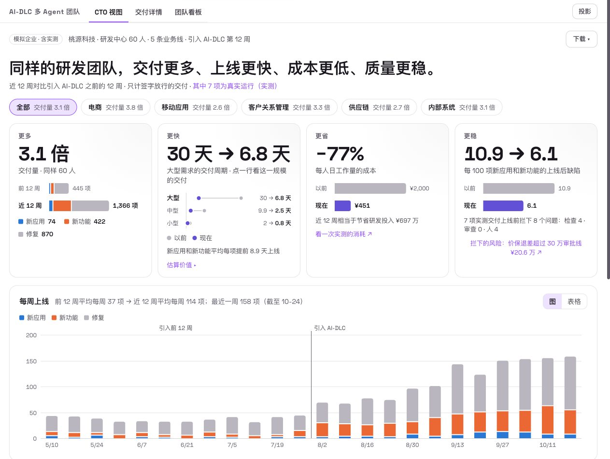
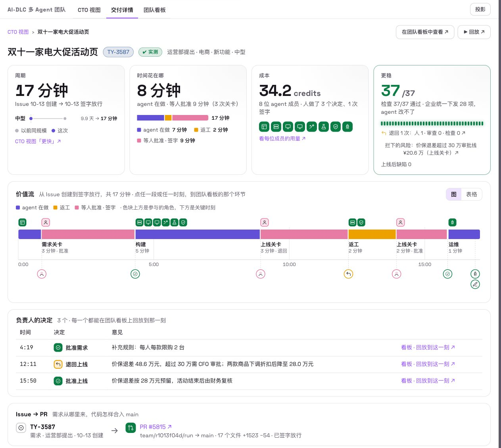
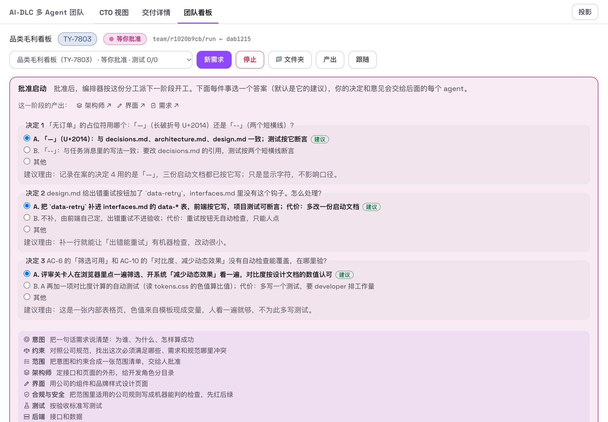
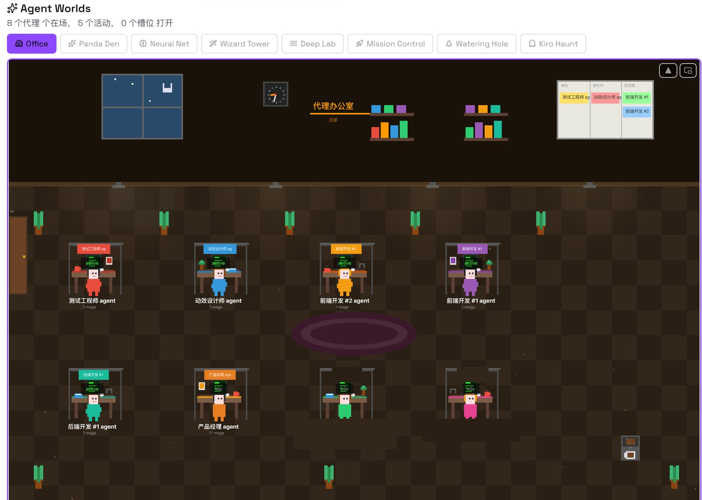

# AI-DLC agent team on Kiro Crew

A Kiro Crew app in which a team of AI-DLC expert agents turns a one-sentence requirement into a tested, reviewed
web feature running on your Mac, while you make the decisions at the gates.

## Quick start

**You need** a Mac, [Kiro Crew](https://kiro.dev/docs/crew/) 0.8 or newer (open, signed in, with credits) and
Node.js 22 or newer.

**1. Install** (about 10 minutes):

```bash
git clone https://github.com/aws-samples/sample-ai-for-software-engineering-on-aws.git
cd sample-ai-for-software-engineering-on-aws/samples/agent-team-on-kiro-crew
bash setup.sh
```

Setup asks once whether the app may auto-approve the agent sessions it opens. Answer `y` so that the team can work
on its own, and use a machine without production credentials ([why](#guardrails)).

**2. Run a delivery** (15 to 20 minutes):

1. In Kiro Crew, open **Apps → AI-DLC 多 Agent 团队**, then the **团队看板** (team board) tab.
2. Click **新需求** (new requirement). The box already holds a ready-made promotion requirement; click **交给团队**
   (hand to the team).
3. When a gate opens, click **✓ 批准** (approve). The team stops at two gates: requirements and release.
4. When the run is done, open the site the team built (**看产出 → 打开网站**) and click **签字放行** (sign off).

**3. Remove it:** `bash cleanup.sh` removes only what setup created.

A run costs Kiro Crew credits (34 to 51 per delivery in our runs) and creates no AWS resources. The sample is in
early development, and its board is in Simplified Chinese.


*The team board during a run: each box is an agent, and the test wall on the right shows the company's checks.*

## What it does

A one-sentence requirement goes in. An orchestrator forms a team of
[AI-DLC](https://github.com/awslabs/aidlc-workflows) expert agents for it, each role a real
[Kiro Crew](https://kiro.dev/docs/crew/) session. The roles work in parallel on their own git branches and look up
the company's standards in a Kiro Crew knowledge base. Company-issued checks decide what passes, and every failure
goes back to the role that owns it. An independent reviewer reads the diff, and a person decides at the gates. The
result is deployed on your machine, and the person who owns the delivery signs it off. A live board shows all of it
as it happens.

- [So what: more delivered, earlier revenue, lower cost, fewer defects](#so-what-more-delivered-earlier-revenue-lower-cost-fewer-defects)
- [How: AI-DLC, a knowledge base and a team of agents](#how-ai-dlc-a-knowledge-base-and-a-team-of-agents)
- [Why Kiro Crew](#why-kiro-crew)
- Reference: [Install and run in detail](#install-and-run-in-detail) · [Guardrails](#guardrails) · [Use it with your own team](#use-it-with-your-own-team) · [The example](#the-example) · [Layout](#layout) · [Develop and test](#develop-and-test) · [Known limitations](#known-limitations)

## So what: more delivered, earlier revenue, lower cost, fewer defects

AI coding assistants make one engineer faster at writing code. How fast an organization delivers is decided
elsewhere: by how long a requirement waits to be clarified, how many decisions wait for someone, how much work
comes back from testing, review and release approval, and how much of the company's own rules has to be checked by
hand. This sample moves the work between those points to a team of agents and keeps people on the decisions, so
that the same people deliver more, sooner and at a lower cost per unit of work, without more defects reaching users.

### What it adds up to for an organization (simulated)

The app's CTO view ships with a simulated development organization: 60 people in 5 business lines, with 12 weeks
of deliveries before the agent team and 12 weeks after. A new installation opens on these figures. They are
simulated, to show what the sample measures and the effect it is built to make visible; they are not results.

| Outcome | 12 weeks before | 12 weeks after | Change |
| --- | --- | --- | --- |
| **Efficiency**: deliveries, same 60 people | 445 | 1,359 | 3.1 times, from 37 to 113 a week |
| **Efficiency**: cycle time from issue to release, large / medium / small | 29.8 / 9.9 / 2.0 days | 6.8 / 2.5 / 0.8 days | large requirements about 4 times faster |
| **Revenue**: new applications and features released | | 489, each 8.8 days earlier on average | value = 489 × 8.8 days × gross margin per day; at CNY 1,000 a day each, about CNY 4.3 million in the 12 weeks |
| **Cost**: per person-day of work delivered | CNY 2,000 | CNY 452 | 77 % lower, about CNY 6.9 million less development spend in the 12 weeks |
| **Quality**: defects reported after release, per 100 new applications and features | 10.9 | 6.1 | 44 % fewer; the measured runs also show what was caught before release, and the risks people noted when they sent work back |

How the CTO view computes them (the values are in `app/cto/history.json`, made by `app/scripts/cto_history.py`):
a delivery counts once a person has signed it off; cycle time runs from the issue's creation to the release; the
work a delivery is worth is 1, 5 or 30 person-days for a small, medium or large one, and the people's own effort
with the agent team is 0.25, 1 or 7 person-days; cost per person-day of work is (people's person-days × CNY 2,000 +
agent subscriptions at USD 40 per person per month) ÷ the person-days of work delivered. The view does not guess
revenue: you enter the gross margin a new application or feature brings per day, and it multiplies. A defect
reported after release is a fix that links back to what it fixes; a measured run has had no time after release
yet, so it is not counted in the defect rate.



*The CTO view (labelled 模拟企业 · 含实测, simulated organization with measured runs). This screenshot also
counts seven runs that had been signed off on the machine, so its totals are slightly higher than the table. The
更稳 (steadier) card shows what those runs caught before release (checks, review, people) and the largest risk a
person noted at a gate: a promotion plan whose price-protection refunds were over the approval limit, sent back
and cut by CNY 206,100.*

### What one delivery takes (measured)

The simulated organization is built around what single deliveries take in real runs. Measured in October 2026,
from the run records the app keeps for each run (`run.json` and `events.jsonl`):

| Run | Team | Requirement to deployed | Of which waiting for a person | Credits | Checks passed at release | Sent back before release |
| --- | --- | --- | --- | --- | --- | --- |
| 1 | Promotion feature, 8 agents | 13 min | 6 min at 2 gates | 34 | 40/40 (28 issued by the company) | 1, by the person at the release gate: the reviewer passed the code but reported that the promotion plan failed the pre-launch check (price-protection refunds above the approval limit) |
| 2 | Promotion feature, 8 agents | 20 min | 11 min at 2 gates | 36 | 40/40 (28 issued by the company) | 3, by the checks: two failing acceptance tests went to their developers, and a wrong test went back to the tester |
| 3 | New internal web page, 13 agents | 67 min | 27 min at 2 gates | 48 | 26/26 (8 issued by the company) | 1, by the checks |
| 4 | New internal web page, 13 agents | — (a gate waited overnight) | — | 51 | 26/26 (8 issued by the company) | 3, by the checks; 2 rounds of discussion at the gates |

- **Speed.** For the promotion feature, the eight agents needed about 7 to 10 minutes of the elapsed time; the
  rest was a person deciding at a gate. The time a delivery takes becomes mostly the time people need to decide.
- **Quality.** No change reaches a person's release gate before it passes the company's checks. The first merged
  work in run 2 passed 5 of the 28 company checks; the failures went back to their owners automatically until all
  40 checks passed. A read-only reviewer then read the whole diff. In run 1 the reviewer passed the code and
  reported that the promotion plan itself failed the pre-launch check; the person sent it back at the release gate,
  and the plan was changed before it went live.
- **Cost.** 34 to 51 credits per delivery, visible per agent.



*Delivery detail of one measured run: 17 minutes from issue to sign-off, of which 8 minutes agent work and 9
minutes waiting for a person at 3 gates; 34.2 credits across 8 agents; 37 of 37 checks, 28 of them issued by the
company; sent back once by the person. The value stream shows where the time went; every segment opens the team
board at that moment.*

## How: AI-DLC, a knowledge base and a team of agents

### AI-DLC: phases and human gates

[AI-DLC](https://github.com/awslabs/aidlc-workflows) (AI-Driven Development Life Cycle) is AWS's open method for
building software with AI doing the work and people approving at defined points. AI-DLC 2.0 organizes delivery into
5 phases and 33 stages, from initialization through ideation, inception and construction to operation, with human
approval gates between them, and defines 14 agents (11 domain experts, 2 reviewers and an adaptive composer) that
lead or support those stages.

The orchestrator in this sample follows those phases and uses the experts' definitions verbatim as the agents'
prompts. A run of the AI-DLC expert team goes like this:

1. **Form the team.** The words in the requirement choose a team file, the way AI-DLC's composer chooses a scope.
   The preview shows which roles join, which company standards apply and whether the knowledge base is ready.
2. **Ideation (stages 1.1 to 1.4).** Intent, constraints against the company's rules, and a scope with the
   questions that need a person's decision. **Gate 范围 (scope):** the person answers each question (the role's
   recommendation is the default), discusses with the role, approves or sends it back.
3. **Inception (stages 2.3 to 2.8).** Architecture and interface contracts with the work split, page design,
   acceptance criteria. **Gate 启动 (build start):** nothing is built before the person approves.
4. **Construction (stages 3.2 to 3.6).** Security and compliance rules become checks; tests are written from the
   acceptance criteria; the back-end and web roles (and a mobile role when the approved work split includes one)
   build in parallel, each on its own branch. The orchestrator merges, runs every check, and sends each failure to
   its owner.
5. **Review and operation (stages 4.1 and 4.3).** A read-only reviewer reads the whole diff. **Gate 上线
   (release):** the person approves, the deploy role deploys on `127.0.0.1`, and the person signs off.

The person's decisions go into every later role's task and into `docs/aidlc/decisions.md` on the run branch, so
the architect builds on what was decided, not on what the scope role guessed.



*The 启动 (build start) gate. The roles raised three questions; each has options, a recommended answer and the
reason. The person picks an answer per question, can choose 其他 (other) and write their own, or open a discussion
with the role before deciding.*

### The knowledge base: the company's standards, looked up and enforced

- **Written once, as documents.** The company's standards (such as brand, front-end engineering, personal information,
  account security, pricing and promotion compliance, margins, price protection) and the descriptions of its data
  are a Kiro Crew knowledge source.
- **Matched to the requirement.** For each run the orchestrator picks the standards that apply, by the words in the
  requirement plus those that always apply (`app/packs/taoyuan/standards.json`), and names them in each role's task
  together with the knowledge source.
- **Looked up and cited.** The agents search the knowledge base before they write, read the data files it points
  to, and cite the rule they followed (for example PRC-1 or MGN-2) in their output. The board counts each agent's
  lookups.
- **Enforced as checks.** The same rules exist as checks the company issues (`app/packs/<pack>/tests/enterprise/`),
  copied into every run and run by the orchestrator. The agents cannot change them.

### A team of agents: the 14 AI-DLC experts, working in parallel

Each role runs as one AI-DLC expert in its own Kiro Crew session, on its own git worktree and branch, and may write
only its own paths. The orchestrator dispatches roles as soon as what they depend on is settled, so independent
roles work at the same time; it merges each branch into the run branch, runs the checks after every merge, and sends
each failure to the role that owns the failing test. A read-only reviewer reads the result before the release gate.

All 14 AI-DLC experts are installed as Kiro Crew members. The two example teams use nine of them; the other five are ready for
teams you write.

| Expert | Responsibility in AI-DLC | In the example teams |
| --- | --- | --- |
| `aidlc-product-agent` | Product manager: intent, scope, requirements, user stories | Intent, scope and requirements roles |
| `aidlc-product-lead-agent` | Reviews requirements and UX for completeness and testability; the customer's voice at the quality gate | Not used |
| `aidlc-architect-agent` | Domain and contract design, non-functional patterns, component decomposition | Architect: interfaces and work split |
| `aidlc-architecture-reviewer-agent` | Reviews designs for soundness, hidden dependencies and unachievable targets | Read-only reviewer before release |
| `aidlc-design-agent` | Wireframes, interaction design, accessibility, design-system compliance | Page design |
| `aidlc-developer-agent` | Code generation, reverse engineering, data modelling | Back-end, web, mobile and promotion developers |
| `aidlc-quality-agent` | Test strategy, test cases, quality gates | Tester |
| `aidlc-devsecops-agent` | Threat modelling, security requirements, secure design review | Security and compliance rules as checks |
| `aidlc-compliance-agent` | Compliance mapping, data classification, risk assessment | Constraints in ideation; compliance review in the promotion team |
| `aidlc-pipeline-deploy-agent` | CI/CD, deployment strategy, release execution | Deploy role |
| `aidlc-aws-platform-agent` | Infrastructure design and environment provisioning on AWS | Not used (the sample deploys locally) |
| `aidlc-operations-agent` | Observability, incident response, operational optimization | Not used |
| `aidlc-delivery-agent` | Team formation, sequencing, phase handoffs | Not used (the orchestrator forms the team) |
| `aidlc-composer-agent` | Composes the minimum workflow from the intent's uncertainty and risk | Not used (team files are chosen by keywords) |

A company can add its own experts next to the official ones. The example adds one, a brand-motion designer, as an
optional role: when its member exists in Kiro Crew it joins the promotion team; when it does not, the team builds
without it and its checks do not run.

### A general framework

Nothing in the orchestrator is specific to the example. A team is a JSON file: its roles and which expert each runs
as, who depends on whom, what each role may write, which checks run and who owns which failing test, where the gates
are, and what a run starts from. The sample ships three teams, and a run picks one by the words in the requirement
(a fourth, `team.json`, is a minimal built-in team that the tests use):

| Team file | Roles | Human gates | Starts from | Checks | Deploys to |
| --- | --- | --- | --- | --- | --- |
| `team-aidlc.json`, AI-DLC expert team (any new requirement) | 13 | 范围 scope, 启动 build start, 上线 release | `starters/web` | 8 company checks (`packs/taoyuan-web`) | `127.0.0.1:8085` |
| `team-taoyuan-promo.json`, shopping-festival promotion | 8 | 需求 requirements, 上线 release | `starters/mall` | 28 company checks (`packs/taoyuan-promo`) | `127.0.0.1:8090` |
| `team-bugfix.json`, two-person bug fix | 2 | none | a project folder you name | none | none |

The test wall shows the company checks together with the tests the team writes itself, so a run usually counts
more checks than the table. The ports are defaults: the deploy role writes the port it wants, and when that port is
taken the site goes on a free one.

## Why Kiro Crew

[Kiro Crew](https://kiro.dev/docs/crew/) is an open-source AI agent that runs locally or on your own hardware, and
an app platform. The sample is a Kiro Crew app, and leans on what Kiro Crew already provides instead of building it:

| What the team needs | What Kiro Crew provides |
| --- | --- |
| A place for the orchestrator and the board to run | The [App Kit](https://kiro.dev/docs/crew/apps/): an app can contribute agents, skills, MCP servers, scheduled jobs, dashboard pages and backend processes. This app is a Python backend that Kiro Crew loads and a React page in the Kiro Crew window, installed from a folder |
| One working agent per role | Chat sessions with the model, tools and MCP servers of a [custom agent](https://kiro.dev/docs/crew/capabilities/). The app opens them through Kiro Crew's local API; you can open any role's session, read it and step in |
| A team that is defined, not coded | Members (Customize → Teammates) in a workspace. Each AI-DLC expert is a member built from its official definition; adding or removing a member changes who can join a run |
| Company standards the agents cite | [Knowledge](https://kiro.dev/docs/crew/features/): a local folder becomes an indexed source, and the agents search it and cite the rule they followed |
| Getting better over time | [Memory](https://kiro.dev/docs/crew/features/) that builds from conversations (preferences, history, lessons and semantic facts) and stays visible and editable |
| Control over what the app may do | Third-party apps are off until trusted; an app acts on sessions only after you grant it; the app asks only for the API routes it uses (`app.json`) |
| An open app ecosystem | Apps work side by side: Agent Worlds, another app that comes with Kiro Crew, shows this app's agents at their desks with no integration code |

Because the app talks to Kiro Crew only through its local API, it needs no change to Kiro Crew, and the same app
works wherever Kiro Crew runs.



*Agent Worlds, another Kiro Crew app, during the same run: it picks up this app's agents by itself, one desk per
agent.*

## Install and run in detail

### Prerequisites

- A Mac with macOS. The scripts and the app have been tested on macOS on Apple silicon only.
- [Kiro Crew](https://kiro.dev/docs/crew/) 0.8.0 or newer, running and signed in, with credits on the account. The
  sample has been run end to end on Kiro Crew 0.8.0.9 and 0.9.0.4.
- Node.js 22 or newer, git and python3 (`xcode-select --install` provides git and python3).
- Network access to registry.npmjs.org for the board's build dependencies (about 100 MB).

### Install

```bash
git clone https://github.com/aws-samples/sample-ai-for-software-engineering-on-aws.git
cd sample-ai-for-software-engineering-on-aws/samples/agent-team-on-kiro-crew
bash setup.sh
```

`setup.sh` takes about 10 minutes and is safe to re-run. It:

1. checks the prerequisites and that Kiro Crew is running;
2. builds the board, installs the app into Kiro Crew and adds it to Kiro Crew's trusted apps (this one app only).
   It asks once whether the app may auto-approve the sessions it opens (see [Guardrails](#guardrails)). If Kiro Crew
   keeps its trusted apps in a local configuration file that the API cannot change, setup says so: add `aidlc-team`
   to the trusted apps in Kiro Crew's settings and run `setup.sh` again;
3. installs the example: files under `~/workplace/taoyuan/`, 15 agent templates in `~/.kiro/agents/`, a Kiro Crew
   workspace, 15 members and a knowledge source. What exists already is kept; an agent template with the same name
   and other content is backed up to `~/.kiro/agents/.aidlc-team-sample-backup/` before it is replaced;
4. waits until Kiro Crew has indexed the knowledge source.

Keep the folder where it is after setup: Kiro Crew installs the app from it.

### Run your first delivery

1. In Kiro Crew, open **Apps → AI-DLC 多 Agent 团队**. The app opens on the CTO view (CTO 视图). Switch to
   **团队看板** (team board) in the app bar.
2. Click **新需求** (new requirement). Pick the ready-made promotion scenario to fill in the box, or write your own
   requirement in one sentence. Leave the team on automatic: the preview shows which team the words select, which
   members it uses and which standards apply. Click **交给团队** (hand to the team).
3. Watch the team graph. Hover over a role to see its task, what it did and the credits it used, and to open its
   Kiro Crew session. The test wall turns green as checks pass; failures go back to their owners.
4. At each gate, click **✓ 批准** (approve), **讨论** (discuss) or **退回** (send back). The dialog shows the role's
   documents, the questions it wants you to decide, and the discussion so far.
5. When the run has been delivered, the site is deployed: open it from the deploy role's outputs (**看产出 →
   打开网站**, view outputs → open site), or at the port the board shows. Then fill in **签字人** (who signs) and click
   **签字放行** (sign off). The delivery joins the CTO view marked 实测 (measured), with its own delivery detail:
   cycle time, agent time versus waiting, credits, checks and send-backs.

The sample creates no AWS resources. A run costs Kiro Crew credits for the agents' sessions (see
[Kiro pricing](https://kiro.dev/pricing/)); the measured runs above used 34 to 51 credits each.

### See what it adds up to

- **Revenue from earlier releases.** In the CTO view, open 估算价值 (estimate value) and enter the gross margin a new
  application or feature brings per day.
- **Your own organization.** Replace `app/cto/history.json` with your own delivery history in the same format
  (`app/scripts/cto_history.py` shows every field), set your day rate and subscription cost in its `meta`, and keep
  signing off the deliveries your teams run through the agent team. The same three cards then compare your own
  period before with your period after.
- **Your own team and standards.** See [Use it with your own team](#use-it-with-your-own-team).

### Remove it

```bash
bash cleanup.sh --dry-run   # list what will be removed
bash cleanup.sh             # remove it: type "remove" to confirm
```

It removes only what `setup.sh` recorded as created in `.install-state.json`: the app (stopping any site it
deployed), the sessions of finished runs, the app's data and the run repositories in `~/workplace/aidlc-team/`; the
members, the workspace and the knowledge source; the agent templates, putting back any it replaced; and
`~/workplace/taoyuan/`. Whatever existed before setup is left alone, and so is Kiro Crew itself.

## Guardrails

What the sample enforces:

- **Human gates.** A run stops at each gate until a person decides: answer each question, discuss with the role,
  approve, or send it back with a note. On the AI-DLC expert team nothing is built before the 启动 gate. A person
  who sends work back can note the risk it keeps from going live (what, and how much); the 签字单 (sign-off sheet),
  the delivery detail and the CTO view's 更稳 card show it.
- **Company checks.** The checks under `packs/<pack>/tests/enterprise/` are copied into every run repository and run
  by the orchestrator, not by the agents. A failure goes back to the role that owns the file, up to a fixed number of
  fix rounds.
- **Write scopes.** Each role has the paths it may write. Changes outside them are recorded as violations when the
  orchestrator merges the role's branch.
- **Independent review.** A read-only reviewer reads the whole diff and can send work back.
- **Local deployment only.** The app starts each site with `HOST=127.0.0.1`, and after it answers, asks `lsof` what
  it listens on: a site that listens on all interfaces or on a network address is stopped, with the reason on the
  board. Nothing is deployed to any cloud account.
- **Sign-off.** Only a delivered run can be signed. Signing merges the run branch into `main` of the run's own
  repository and records who signed and every human decision.

What it does not enforce, and how to run it safely:

- If you agree during setup, the app sets **the sessions it opens** to auto-approve their tool calls, and the
  members' templates allow file reads and writes and shell commands. The agents can then run shell commands on your
  Mac without asking. Write scopes are checked at merge time, not prevented while an agent works. Run the sample on a
  machine and user account **without production credentials or customer data**. If you do not agree, every tool
  call waits for your approval in Kiro Crew.
- The agents' sessions send their prompts, the code they read and the knowledge they look up to the model service
  that Kiro Crew uses. Use only data you are allowed to send there; the example data is synthetic.
- Generated code is not reviewed for production use. Read what the team built before you use any of it.
  Generative AI can make mistakes; see the [AWS Responsible AI Policy](https://aws.amazon.com/ai/responsible-ai/policy/).

## Use it with your own team

- **A team file** in `app/team/` defines the roles (`key`, `member`, `depends_on`, `writable`, `outputs`, `brief`,
  `gate`, `questions`, `deploy`), what a run starts from (`starter` or `source`), the checks (`spec_pack`,
  `test_command`, `test_owners`), the knowledge source, the Kiro Crew workspace and the words that select it
  (`scope`, `keywords`, `priority`, `fallback`). [app/README.md](app/README.md) lists every key and the code that
  reads it.
- **A starter** in `app/starters/` is the project a run begins from. **A pack** in `app/packs/` holds the checks your
  company issues (`tests/enterprise/`), which the agents cannot change.
- **Members**: each role runs as a Kiro Crew member. Create the members in Customize → Teammates, or adapt
  `example/agents/make_templates.py`. A role marked `"optional": true` whose member does not exist sits the run out,
  and its checks do not run.
- **Knowledge**: add a local folder as a Kiro Crew knowledge source and name it in the team file.

After a change to the app, run `bash setup.sh` again (or `app/scripts/dev-install.sh`) to update it in Kiro Crew.

## The example

The sample ships example information that simulates the business rules, data and delivery flow of a
consumer-electronics retailer, so that the team has realistic standards to follow and data to work with. All
names, numbers and records in it are invented. `example/` holds:

- `knowledge/`: the standards (brand, front-end engineering, personal-information display, account security,
  annual-party lottery rules, price and promotion compliance, margin and pricing, price protection) and
  descriptions of the data;
- `data/`: products, 60 days of orders, a promotion plan, an employee list, prizes and a list of weak passwords;
- `agents/make_templates.py`: builds the Kiro agent templates of the 15 members, the 14 AI-DLC experts and the
  brand-motion expert the example adds.

The app's `starters/` (project templates), `packs/` (the checks the company issues) and `team/roster-taoyuan.json`
(the development team the board shows) belong to the same example.

## Layout

| Path | Contents |
| --- | --- |
| `app/` | The Kiro Crew app `aidlc-team`: orchestrator (`backend/`), board and CTO view (`ui/`), teams (`team/`), starter projects (`starters/`), company checks (`packs/`), tests. See [app/README.md](app/README.md) |
| `example/` | The example information: knowledge base, data, member templates |
| `vendor/aidlc-workflows/` | The 14 AI-DLC expert definitions, copied unmodified from awslabs/aidlc-workflows (MIT-0) |
| `docs/images/` | The screenshots on this page |
| `setup.sh`, `cleanup.sh`, `scripts/` | Install into Kiro Crew; remove what setup created (recorded in `.install-state.json`) |

## Develop and test

```bash
cd app
python3 -m pytest -q               # backend: Python 3.10+ and pytest; fake Kiro Crew sessions, real git and node
cd ui && npm ci && npm run check   # board: type check, component tests, build
```

`npm run preview:build` builds `ui/preview-dist/index.html`, the board and CTO view on test data without Kiro Crew.

## Known limitations

- The board, the team definitions, the agents' briefs and the example data (including the READMEs of the starters
  and packs) are in Simplified Chinese.
- macOS only; one run at a time.
- Kiro Crew 0.9 renamed the members page to Customize → Teammates. Some hints on the board still call it 「代理」
  (agents), the name in Kiro Crew 0.8.
- The orchestrator follows the AI-DLC phases and uses the official expert definitions; it does not run the AI-DLC
  workflow engine or its plugins.

## Acknowledgements

The app started as a fork of the `kirocrew-team` Kiro Crew app by ychchen. The expert definitions come from
[AI-DLC Workflows](https://github.com/awslabs/aidlc-workflows).
