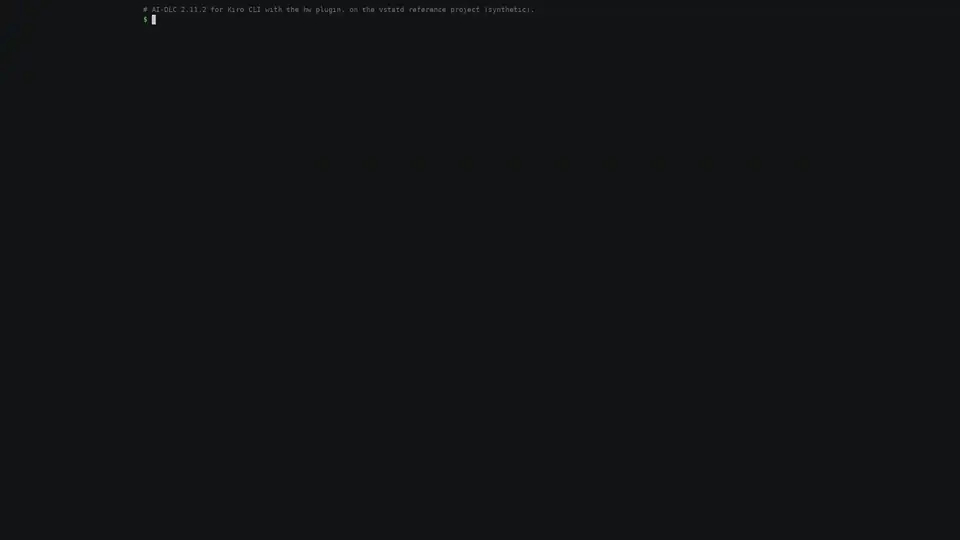
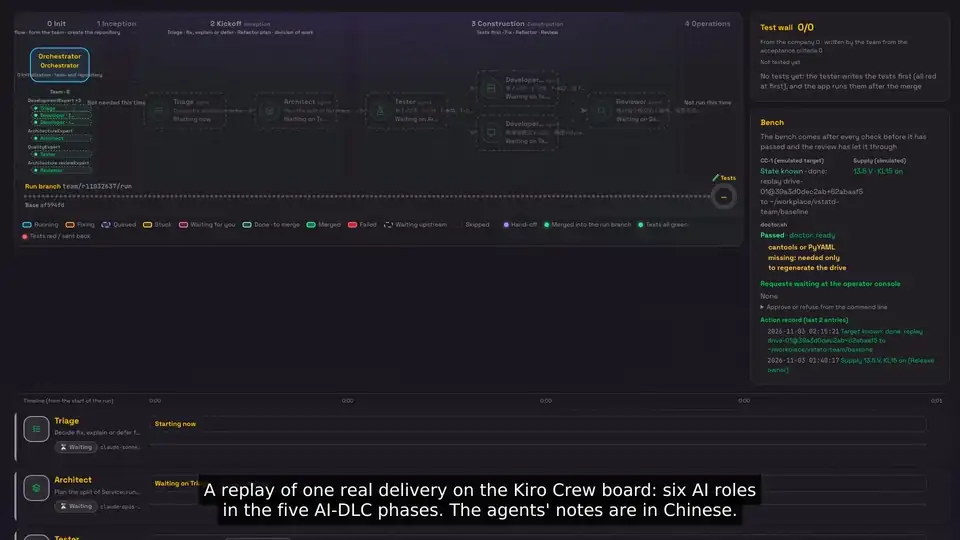
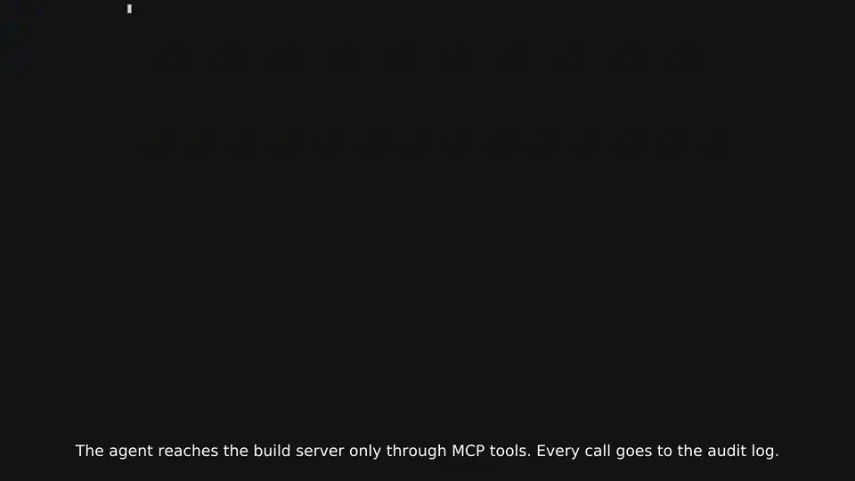

# Demos: the embedded samples running

Three short recordings of the embedded samples on their synthetic data. They play here as silent animations with
burned-in English captions; the caption text is also in [`.srt` files](captions/). Waits are shortened by speeding up,
cutting or holding a frame; nothing is reordered. Where a person's part was typed or scripted, the section says so. No
people and no customer data appear in them.

| Recording | What it shows | Length |
| --- | --- | --- |
| [The `hw` plugin in Kiro CLI](#the-hw-plugin-in-kiro-cli) | A real `/aidlc` run with the [`hw` plugin](../aidlc-plugin/hw/), up to its first hardware approval gate | 1:46 |
| [One delivery on the Kiro Crew board](#one-delivery-on-the-kiro-crew-board) | The [in-vehicle app](../in-vehicle-dev-server/README.md#the-kiro-crew-app) from the triage gate to sign-off | 1:25 |
| [The build server's guardrails](#the-build-servers-guardrails) | The [`build` MCP server](../in-vehicle-dev-server/mcp/build/README.md) refusing, bounding repairs and handing over to a person | 1:03 |

## The hw plugin in Kiro CLI

Kiro CLI 2.34.0 runs AI-DLC Workflows 2.11.2 as shipped, with the `hw` plugin, on a copy of the in-vehicle reference
project with its hardware sources. It shows the plugin's step in Requirements Analysis, the core reviewer's gaps and
the team's answers, and the plugin's Hardware Verification Planning stage, where every requirement gets an evidence tier
and the check that judges it. The run stops at that stage's approval gate, which was not approved. The answers at the
gates were typed by the sample's authors from the facilitator notes, and only read-only shell commands were approved;
the names of other projects' container images on the machine are masked. Recorded 2026-11-05: 78 minutes in all (77 to
the gate) and 88.73 credits, shortened to under two minutes. Construction and Operation have not run with the plugin.

## One delivery on the Kiro Crew board

A replay of run `r11032637` (2026-11-03, a Mac with Apple Silicon) on the board of the [in-vehicle Kiro Crew
app](../in-vehicle-dev-server/README.md#the-kiro-crew-app): six AI roles, people only at the gates and on the bench, the
checks sending failures back to the role that owns them, the bench, the independent rerun and the release owner's
sign-off. The board is in presentation mode, so people are shown by role. The agents' notes are in Chinese. The 3:38
screen recording is shortened to 1:25 by speed changes only, with holds while the narration plays. Two things differ
from the sample today: the memory limit on the screen is the 8,192 KiB of that day, later set to 6,400 KiB from 70
replays ([facilitator notes](../in-vehicle-dev-server/rehearsal/facilitator-notes.md)), and the scorecard's top row adds
two runs (the per-run row is this delivery). The figures of this run are in the scenario's
[Cost](../in-vehicle-dev-server/README.md#cost).

## The build server's guardrails

[`rehearsal/build-server-run/run.py`](../in-vehicle-dev-server/rehearsal/build-server-run/README.md) on an Ubuntu build
host: a script plays both sides: the agent, which calls the `build` MCP server's tools, and the people. Calls outside
the agent's grant are refused, wrong repairs of the cross build count until the server refuses the next attempt, a
person resets the count, ThreadSanitizer finds the seeded data race, and the release check fails with its reasons
because there are no bench results in this walk. 35 of 35 rows as expected; the recorded run took about six minutes.