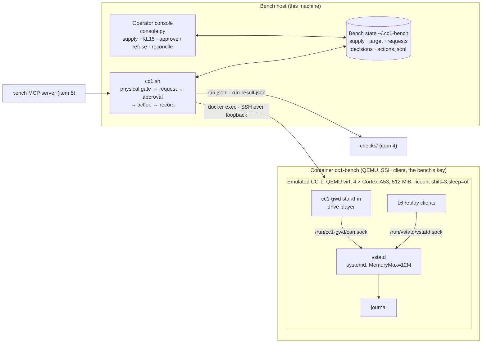

# Bench: the emulated CC-1

> **Status: in development.** Build plan item 3 of the [in-vehicle scenario](../README.md#build-plan). Built so far:
> the target image and sysroot, the emulated CC-1, deployment with digest read-back, the recorded drive and its
> player, the replay clients, the run directories for the checks, the simulated supply, the physical gate, the
> operator console, the action record, reset and doctor. Still to do: the final baseline (see [Open](#open)).

The bench is the half of the scenario that stands in for the cockpit computer and its test bench, on one machine and
without automotive hardware. It is for the bench owner and the person at the operator console. The agents never use
it directly: they reach it through the `bench` MCP server (build plan item 5), which calls `cc1.sh`.



## Quick start

```bash
bench/build-target.sh                          # target image and sysroot into Docker volumes (first build: about 40 min here)
bench/doctor.sh                                # check the host
python3 bench/console.py                       # in its own terminal: the operator console
bench/cc1.sh start && bench/cc1.sh wait        # boot the emulated CC-1 from the pristine image
bench/cc1.sh deploy <stripped vstatd>          # waits for an approval at the console
bench/cc1.sh replay --kind baseline --out runs/baseline
bench/cc1.sh replay --kind run --out runs/run-1
checks/logdiff.sh --run runs/run-1 --baseline runs/baseline --results results --triage <triage.json>
```

At the console, set the supply first (`v 13.5`, `k on`): with no supply set, every physical action is refused.

## The emulated CC-1

| Part | What it is | Spec |
| --- | --- | --- |
| `image/` | Buildroot 2026.02.3 with the br2-external tree `image/br2-external/` (`cc1_defconfig`): aarch64, glibc, systemd, Linux 6.18.7, dropbear, the bench tools (`package/cc1-bench`). Built in `image/Dockerfile`, into Docker volumes, because Buildroot needs a case-sensitive file system | CC1-PN §2.1 |
| Sysroot | Buildroot's staging directory, exported to the volume `cc1-sysroot`. Mount it at `/opt/cc1-sysroot` in the build container of `reference-project/tools/` | CC1-PN §7.2 |
| `runner/` | The container that runs QEMU and holds the bench's SSH key (volume `cc1-bench-secrets`). The public key reaches the target through QEMU's fw_cfg; the image carries no key | — |
| Time | `-icount shift=3,sleep=off`. The exact command line is kept with every run | CC1-PN §2.2 |
| Known state | Every `start` boots from a fresh copy of the pristine root file system. `vstatd` is installed by `deploy`, disabled by a systemd preset and started only by a replay or a restart. `reset` stops it, empties `/run/vstatd` and checks that the approved build is installed | CC1-PN §8.3 |

## The recorded drive and the replay

`drives/make_drive.py` writes `drives/drive-01.rec` from VSS values: each value goes through
`knowledge/vss-mapping.yaml` and `knowledge/cc1-gateway.dbc` (cantools) into a CAN frame, so the frames always agree
with the DBC. The drive is 36 s with 3,998 frames and one gateway loss. Its timing is the bench's half of the
interface with the reference project:

| Rule | Value | For |
| --- | --- | --- |
| First frame of every message after each connection | 0.15 to 1.0 s, inside 0.1 to 1.5 s | No `SIGNAL_TIMEOUT` at start-up in the baseline; F-008 wrong fix A |
| `BCM_Exterior` after the reconnection | silent for 7 s, longer than the 2 s grace period plus its 3 s timeout | One `SIGNAL_TIMEOUT` and `SIGNAL_RECOVERED` in the baseline; F-008 wrong fix B |
| Replay clients | 16, at 1.2 s + n × 20 ms after the gateway connection, 4 subscriptions each | VSTATD-IF §5.4; F-021 |

In the guest, `cc1-bench` (`player/cc1-bench.cpp`, C++17) plays `cc1-gwd` by the guest's monotonic clock, runs the
16 clients, and at the end of the drive reads `VmHWM`, threads and CPU time before it sends `SIGTERM` to `vstatd`
(CC1-PN §8.5). It waits with inotify, not by polling, so that it takes no guest CPU from `vstatd`. Before each replay
`player/run-replay.sh` writes a marker to the journal and reads it back. The bench then writes the run directory in the
format of [checks/README.md](../checks/README.md#run-and-baseline-directories), plus `approval_request`,
`vstatd_restarts` and `journal_marker`.

## Physical gate, operator console and action record

| Command | Physical gate | Approval at the console | When the target is unknown |
| --- | --- | --- | --- |
| `deploy <vstatd>` | 11.0 to 14.8 V, KL15 on | yes, for the build's digest | refused |
| `restart` | 11.0 to 14.8 V, KL15 on | yes, for the installed digest | refused |
| `replay` | 11.0 to 14.8 V, KL15 on | yes, for the installed digest | refused |
| `stop-vstatd` | none | no, recorded | refused |
| `probe`, `supply`, `target`, `status` | none | no | allowed |

- **Gate first, then a request.** A physical action that fails the gate is refused without a request. The gate is
  checked again after the approval, so a supply change during the wait still stops it (CC1-PN §8.1).
- **A person, the exact build.** The console shows each request with its digest. Approving needs at least the first six
  characters of that digest. An approval is for one action and one digest, and can be used once. No answer within
  `CC1_APPROVAL_TIMEOUT_S` (default 300 s) is a refusal.
- **One action at a time.** A second action is refused while one is running.
- **Unknown after an interruption.** If `cc1.sh` fails or is killed during an action, the target is `unknown`. Only
  reads and a reconcile at the console are accepted until a person has checked it. Nothing is retried.
- **The supply is the console's.** Only the console, or a scripted scenario (`console.py scenario <file>`), sets the
  voltage and KL15. The replayed `Vehicle.LowVoltageSystemState` does not change it (CC1-PN §8.2).
- **Action record.** Every supply change, gate check, request, decision, action, target state change, reconcile and
  reset is appended to `actions.jsonl` with its time, digest and who. The evidence page (item 4) takes its action list
  from it.

> [!WARNING]
> **Trust boundary.** The guardrails hold only if the agents cannot reach the bench state directory, the Docker daemon
> or the runner container. In this sample the agents run in the build container, which has none of them. The owner
> commands of `cc1.sh` (`start`, `stop`, `reset`, `ssh`, `put`, `serial`) bypass the gate by design; the `bench` MCP
> server (item 5) must not offer them.

## Doctor and tests

`bench/doctor.sh` checks Docker, memory, disk, Python, the runner image and its QEMU, the target image and sysroot
volumes, the recorded drive, the bench state (mode 700), the supply, the target state and pending requests.

`python3 bench/tests/test_gate.py` runs 20 tests of the gate and the console without QEMU: supply not set, the voltage
limits, KL15 off, supply change after the approval, the digest prefix, refusal, timeout, an approval for another
digest, one-time approvals, one action at a time, interrupted and failed actions, reconcile, the record only growing,
scripted scenarios and the state directory's mode.

## Measured

On an Apple Silicon Mac with Docker Desktop (6 CPUs, 4.3 GiB), 2026-10-29, with the vstatd of PR #15 (digest
`bc93723c…`, 133,240 bytes stripped):

| What | Result |
| --- | --- |
| Cross build against the sysroot | As committed: fails on `<systemd/sd-daemon.h>` (the seed). With `-DCMAKE_SYSROOT`: builds; needs at most GLIBC_2.38 and GLIBCXX_3.4.22, the sysroot has 2.42 and 3.4.33 |
| Boot to SSH | 17 to 111 s wall clock, depending on host load |
| One replay | 8 to 54 s wall clock, 36 s of guest time |
| Repeatability, one baseline and four runs | shift 5: largest difference per entry 16 to 28 ms, logdiff FAIL 3 of 4. shift 3: 4, 5, 5 and 19 ms, PASS 4 of 4. shift 1: 1, 7, 12 and 18 ms, PASS 4 of 4 |
| Repeatability at shift 3, 2026-11-04 | One baseline and 60 runs over three boots: largest difference per entry 2 to 24 ms (median 5), logdiff PASS 58 of 60; both FAILs (23, 24 ms) a `CLIENT_CONNECTED` when the replay's clients connect. [rehearsal/repeatability/](../rehearsal/repeatability/README.md) |
| F-008 wrong fix A (condition removed) | logdiff FAIL: `SIGNAL_TIMEOUT` and `SIGNAL_RECOVERED` for `VCU_Speed` and `VCU_Gear` at start-up |
| F-008 wrong fix B (flag not set) | logdiff FAIL: the baseline's `BCM_Exterior` timeout and recovery are missing |
| F-021 (`lines_{}`) | Not caught at the first limit of 8,192 KiB: peak RSS 5,944 → 6,752 KiB (+808). On 2026-11-04, 60 normal runs 5,644 to 5,944 KiB and 10 wrong-fix runs 6,608 to 6,872 KiB ([rehearsal/repeatability/](../rehearsal/repeatability/README.md)); the limit is now 6,400 KiB (CC1-PN §3), which every wrong-fix run exceeds |
| Gate, end to end | KL15 off and 10.5 V refused without a request; a refusal and three approvals at the console; a kill during a replay left the target unknown; replay, `stop-vstatd` and `stop` were then refused until a reconcile |

## Open

- **F-021 calibration (closed 2026-11-04).** The peak-RSS limit of CC1-PN §3 is now 6,400 KiB, set from the 70 runs
  of [rehearsal/repeatability/](../rehearsal/repeatability/README.md): 456 KiB above the largest normal run, 208 KiB
  under the smallest wrong-fix run. On another host, see [facilitator-notes](../rehearsal/facilitator-notes.md).
- **Repeatability margin (closed 2026-11-04).** At shift 3, 2 of 60 runs of the same build failed the 20 ms window
  (23 and 24 ms), both on a client's connection time ([rehearsal/repeatability/](../rehearsal/repeatability/README.md)).
  CC1-PN §6.3 now gives `CLIENT_CONNECTED` and `SERVICE_STOP` 50 ms and keeps 20 ms for every other event; with that,
  all 60 runs pass, the smallest margin to a window is 11 ms, and the F-008 wrong fixes are caught as before, since
  they add or remove timeouts rather than shift them.
- **Final baseline.** Generated once the reference project is calibrated, on the commit the scenario ships.
- **Build container on Apple Silicon (closed 2026-11-03).** `reference-project/tools/Dockerfile` now builds natively
  for both architectures: `docker build --platform linux/arm64 -t vstatd-build:arm64 reference-project/tools/` on
  Apple Silicon (the host `g++-12` and `binutils` already target `aarch64-linux-gnu`), `linux/amd64` and
  `vstatd-build:amd64` with the cross compiler on x86_64. The amd64 image under Rosetta cannot run ThreadSanitizer.
- **C++ headers in the sysroot (closed 2026-11-04).** Buildroot keeps the libstdc++ headers and GCC's own directory
  with its cross toolchain in `output/host/` (`aarch64-buildroot-linux-gnu/include/c++/14.3.0`,
  `lib/gcc/aarch64-buildroot-linux-gnu/14.3.0`), not in staging, and clang-tidy takes the C++ headers only from a GCC
  installation it finds in the sysroot under a target name it knows. `image/build-image.sh` now exports them into
  `cc1-sysroot` in the multiarch layout (`usr/lib/gcc/aarch64-linux-gnu/14.3.0`, `usr/include/c++/14.3.0`,
  `usr/include/aarch64-linux-gnu/c++/14.3.0`). With it, `rehearsal/check-examples/` is 23 of 23, as with the stand-in.
  Rebuilding with `bench/build-target.sh` on an existing build took 61 s (38 s for a second rebuild); a first build
  was not timed. The app's checks still mount the stand-in (`vstatd-standin-sysroot`), see
  [docs/kiro-crew-app.md](../docs/kiro-crew-app.md#not-yet-verified).
- **SSH host key.** The target makes a new host key on every boot and the bench does not check it; the connection is
  loopback inside the runner container.
- **QEMU version.** The runner uses Ubuntu 24.04's QEMU 8.2.2, not the QEMU that Buildroot builds for itself.

## Third-party tools

Used as tools and not redistributed; the target image and sysroot are built locally and not committed.

| Tool | Licence |
| --- | --- |
| Buildroot | GPL-2.0-or-later |
| Linux kernel | GPL-2.0 |
| glibc | LGPL-2.1-or-later |
| systemd | LGPL-2.1-or-later |
| dropbear | MIT-style (dropbear licence) |
| QEMU | GPL-2.0 |
| OpenSSH client | BSD-style (OpenSSH licence) |
| GCC (target toolchain built by Buildroot) | GPL-3.0 with the GCC runtime library exception |
| cantools, PyYAML (drive generator) | MIT |

## Cleanup

```bash
bench/cc1.sh stop
docker volume rm cc1-images cc1-sysroot cc1-br-dl cc1-br-work cc1-run cc1-bench-secrets cc1-build-out
docker image rm cc1-image-builder cc1-bench-runner
rm -rf ~/.cc1-bench          # the bench state, including the action record
```
